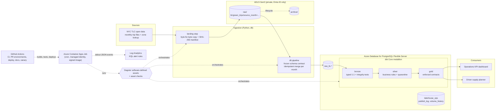
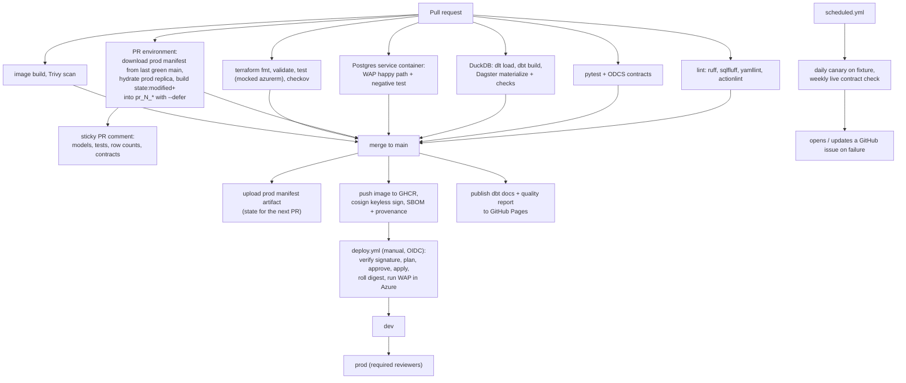
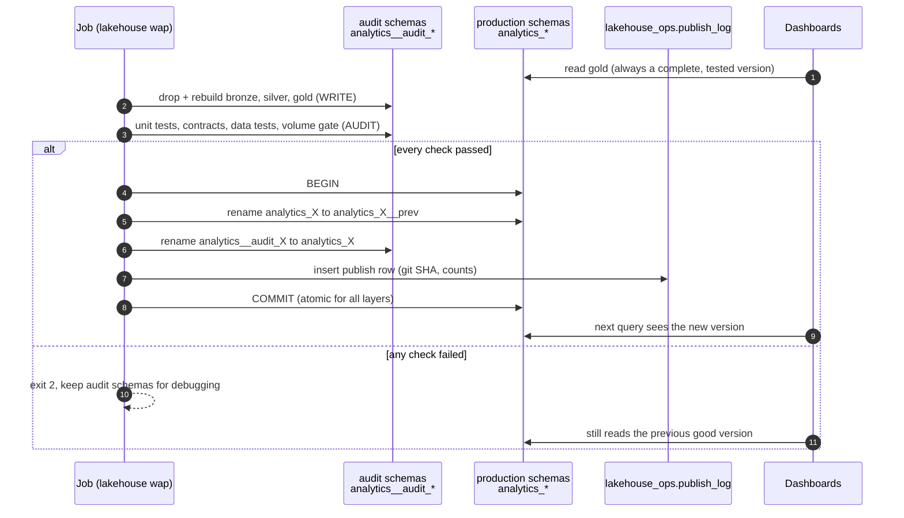

# dataops-lakehouse-platform

[](https://github.com/rsk071216-stack/dataops-lakehouse-platform/actions/workflows/ci.yml)
[](https://rsk071216-stack.github.io/dataops-lakehouse-platform/)
[](https://rsk071216-stack.github.io/dataops-lakehouse-platform/)


[](LICENSE)

A production-shaped, vendor-neutral lakehouse on Azure where **every change to
data is tested like code and every deployment is a pull request**. dlt ingests
NYC taxi data into an ADLS Gen2 landing zone, dbt Core builds a tested
bronze/silver/gold model with enforced contracts, Dagster orchestrates it as
software-defined assets, and GitHub Actions drives everything from per-PR
environments to an atomic **Write-Audit-Publish** release into PostgreSQL.
No Databricks, no vendor pipeline service, no stored passwords.

**Live documentation:** <https://rsk071216-stack.github.io/dataops-lakehouse-platform/>
(dbt lineage graph and data quality report, rebuilt by CI on every merge)

---

## The problem this solves

If you run a data team of 2 to 20 people, you have probably lived through these:

| Pain | What it costs you | How this platform handles it |
|---|---|---|
| A dashboard shows wrong numbers on Monday morning because a bad file arrived on Sunday | Trust in data, executive escalations | **Write-Audit-Publish**: new data is built and tested in isolation; production switches atomically only if every test passes. A failed audit leaves yesterday's correct numbers in place |
| SQL changes are deployed without tests | Silent regressions | dbt **unit tests**, data tests and **enforced contracts** run in CI on every PR, on DuckDB *and* PostgreSQL |
| Deployments are manual, and nobody knows what is live | Weekend outages, key-person risk | One `git merge`. Infrastructure, image and data are released by GitHub Actions with environment approvals and a signed image |
| Nobody knows where a number comes from | Days lost asking "where does this column come from" | Live lineage from raw file to dashboard, published automatically on every merge |
| A provider renames a column and nothing fails until a user complains | Firefighting | **Data contracts** (ODCS) at the ingestion boundary fail the PR or the weekly upstream check, and a frozen dlt schema rejects unreviewed columns |
| Databricks or a managed ELT tool costs more than the data team | Budget | Runs for **about USD 20-30 per month** on Azure (see [cost](#cost-estimate)), all open source, no lock-in |

## Architecture



Locally and in CI the same graph runs on **DuckDB** with the landing zone on the
local filesystem, so the whole platform is testable on a laptop or a GitHub
runner with no cloud account.

### CI/CD flow



### Write-Audit-Publish



## What makes this different

- **Write-Audit-Publish is proven, not described.** On every push CI publishes
  a good delivery, injects a broken one, asserts that the audit fails with exit
  code 2, and then proves that production has the identical publish id and row
  counts in every table. Then it recovers and rolls back.
- **Slim CI without dbt Cloud.** PRs build only `state:modified+`, deferring to
  a production replica rebuilt from the manifest of the last green `main` run.
- **Ephemeral environment per PR** with a sticky comment showing exactly what
  the change produced.
- **Contracts on both edges.** ODCS contracts guard what we ingest; enforced
  dbt contracts guard what we serve.
- **Nothing is dropped silently.** Silver tags every rejected trip with the
  first rule it broke; a singular test proves bronze rows = clean + rejected.
- **Supply chain hygiene.** Every action pinned by SHA, every image by digest,
  Python locked with `uv.lock`, dbt packages locked, Terraform providers exact,
  Dependabot with a 14-day cooldown, Trivy, and cosign keyless signatures that
  the deploy workflow verifies.
- **Zero stored secrets.** GitHub OIDC to Azure, managed identity to storage,
  Key Vault and PostgreSQL (Entra ID auth, password auth disabled).

## Features

| Area | Implementation | Verified in CI |
|---|---|---|
| Ingestion | dlt with explicit typing, frozen schema contract, idempotent `delete-insert` merge | yes, DuckDB and Postgres |
| Landing zone | byte-for-byte copy with SHA-256 manifest; local folder or ADLS Gen2 (`az://raw`) | local path yes, ADLS needs Azure |
| Data contracts | ODCS v3.2.0 via datacontract-cli 1.2.4, plus negative tests | yes |
| Transformation | dbt Core 1.12, medallion layout, 2 targets (duckdb, postgres) | yes, both |
| Testing | 3 unit tests, 44 data tests (generic, dbt_utils, singular, custom generic), 4 enforced gold contracts | yes |
| Orchestration | Dagster 1.13 software-defined assets, dagster-dlt, dagster-dbt, schedule, 41 asset checks | yes, in-process materialize |
| Deployment | Write-Audit-Publish with atomic schema swap, rollback, publish log | yes, Postgres 16 container |
| PR workflow | slim CI with `--defer`, `pr_<n>` schema, sticky PR comment | yes |
| Docs | dbt docs (lineage) + data quality report on GitHub Pages | yes, on main |
| Observability | freshness, volume anomaly, row-count band, rejection SLO, reconciliation; JSON events; KQL alerts; budget | checks yes, Azure alerts need Azure |
| Infrastructure | Terraform azurerm 4.81: RG, ADLS Gen2, Postgres Flexible (Entra), Key Vault (RBAC), Log Analytics, UAMI, Container Apps environment + scheduled job, optional ACR and private networking | `terraform test` with mocked provider |
| Container | uv-built, digest-pinned slim base, non-root, Trivy, GHCR, cosign, SBOM + provenance | yes (push and sign on main) |

## Data model

Business story: a city mobility operations team watching green (boro) taxi
service. Source: NYC TLC trip records, January 2024 (CI fixture: a deterministic
1-in-10 sample, 5,656 trips).

| Layer | Model | Grain | Purpose |
|---|---|---|---|
| bronze | `stg_tlc__green_trips` | one row per delivered trip | typed, renamed 1:1 copy; structural and referential tests |
| bronze | `stg_tlc__taxi_zones` | one row per zone | 265 TLC zones |
| silver | `int_trips__validated` | one row per delivered trip | deterministic `trip_id`, first violated business rule |
| silver | `int_trips__cleaned` | one row per valid trip | the only input to gold |
| silver | `int_trips__rejected` | one row per rejected trip | quarantine with `rejection_reason` |
| gold | `dim_zones` | one row per zone | borough, zone, airport flag |
| gold | `fct_trips` | one row per valid trip | fares, tips, duration, payment method, airport flag, card tip rate |
| gold | `mart_daily_borough_kpis` | pickup date x borough | trips, gross/fare/tip revenue, avg fare, distance, duration, card tip rate, airport share |
| gold | `mart_zone_hourly_demand` | zone x weekday/weekend x hour | trips, active days, avg trips per active day, avg fare |

On the fixture: 5,656 bronze trips, 326 quarantined (5.8%: 280 zero distance,
23 implausible duration, 9 negative amount, 7 non-positive duration, 6
implausible distance, 1 outside the source month), 5,330 trips in gold and
USD 119,794 gross revenue.

## Data quality strategy

| Failure mode | Caught by | Layer | Effect |
|---|---|---|---|
| Upstream drops, renames or retypes a column | ODCS contract (`datacontract test`), frozen dlt schema | ingestion | PR or weekly check fails, issue opened, load rejected |
| Out-of-domain codes (payment type 9, zone 999, vendor 7) | contract ranges; `accepted_values`, `relationships` | ingestion, bronze | audit fails, publish refused |
| Truncated or duplicated delivery | `row_count_between`, WAP volume gate, volume anomaly check | bronze, publish, Dagster | publish refused or warning |
| Late or missing data | dbt source freshness, `raw_trips_freshness` check, dead man's switch alert | raw, Azure Monitor | blocking check, alert |
| Real-world noise (negative fares, zero distance, 50,000 mile trips) | silver rejection rules (unit tested) | silver | quarantined with reason, visible in the quality report |
| Rows lost or duplicated by a filter or join | `assert_silver_accounts_for_every_bronze_row`, `unique` on keys | silver | audit fails |
| Rejection rate spikes | `assert_rejection_rate_within_slo` (<= 15%) | silver | audit fails |
| Mart double counts after a join change | `assert_gold_revenue_reconciles_to_fact`, `unique_combination_of_columns` | gold | audit fails |
| Breaking change for dashboards | enforced dbt contracts (names + types), exposures | gold | build fails before deploy |
| Transformation logic regression | dbt unit tests (rejection priority, labels, tip rate, aggregation) | silver, gold | PR fails |

## Repository layout

```text
.
|-- src/lakehouse/
|   |-- ingest/            landing zone, dlt source, typed mapping (ingestion boundary)
|   |-- orchestration/     Dagster definitions: assets, asset checks, schedule
|   |-- wap/               Write-Audit-Publish: audit, atomic publish, rollback
|   |-- reporting/         data quality report (Pages) and PR summary comment
|   |-- observability.py   freshness / volume anomaly logic and JSON alert events
|   `-- cli.py             `lakehouse` CLI used by laptops, CI and Azure alike
|-- transform/             dbt project (bronze/silver/gold, tests, unit tests, exposures)
|-- contracts/             ODCS v3.2.0 data contracts for the ingestion boundary
|-- data/fixtures/         deterministic CI fixture (+ SHA256SUMS) and a broken late delivery
|-- infra/terraform/       Azure platform, tfvars per environment, mocked `terraform test`
|-- tests/                 pytest: mapping, ingestion, contracts, WAP logic, Dagster graph
|-- docs/adr/              architecture decision records
|-- docs/runbook.md        operations: failed audit, rollback, drift, teardown
|-- site/                  GitHub Pages landing page
|-- scripts/               fixture builder, Postgres role bootstrap SQL
|-- .github/workflows/     ci, pages, scheduled, deploy (+ reusable deploy-environment)
|-- Dockerfile             pipeline image (uv, digest-pinned base, non-root)
|-- Makefile               common commands
`-- uv.lock                locked Python dependencies
```

## Quick start

### Local, no cloud (DuckDB)

Requires [uv](https://docs.astral.sh/uv/) only; uv installs the pinned Python.

```bash
git clone https://github.com/rsk071216-stack/dataops-lakehouse-platform.git
cd dataops-lakehouse-platform
make setup       # uv sync --frozen + dbt deps
make build       # land fixture, load with dlt, dbt build (unit tests, contracts, tests)
make run         # Dagster: materialize every asset and run every check in-process
make test        # pytest (includes contract negative tests)
make dagster     # Dagster UI with lineage at http://localhost:3000
make docs        # dbt docs at http://localhost:8080
```

Without make: `uv run lakehouse ingest && uv run lakehouse build && uv run lakehouse run`.

Write-Audit-Publish locally needs any PostgreSQL 14+ and the usual `PG*`
variables, then `make wap`.

### GitHub Codespaces

Open the repo in a Codespace: `.devcontainer/` installs uv, Terraform and the
Azure CLI and runs `uv sync` and `dbt deps`. Then use the `make` targets above.

### Full Azure deployment

1. **Remote state**: a storage account and container for Terraform state.
2. **Identity**: an Entra ID app registration (or user-assigned identity) with
   federated credentials for `repo:rsk071216-stack/dataops-lakehouse-platform:environment:dev`
   and `...:environment:prod` (plus `dev-plan` and `prod-plan`). Grant it
   Contributor and User Access Administrator on the target scope, and Storage
   Blob Data Contributor on the state container.
3. **GitHub environments** `dev-plan`, `dev`, `prod-plan`, `prod` (add required
   reviewers on `prod`) with these **variables** (no secrets needed):
   `AZURE_CLIENT_ID`, `AZURE_TENANT_ID`, `AZURE_SUBSCRIPTION_ID`,
   `TFSTATE_RESOURCE_GROUP`, `TFSTATE_STORAGE_ACCOUNT`, `TFSTATE_CONTAINER`,
   `POSTGRES_ADMIN_OBJECT_ID`, `POSTGRES_ADMIN_NAME` (the OIDC identity).
4. **Deploy**: Actions > deploy > Run workflow, paste the signed image digest
   from the `container` job summary of a green `main` run, and choose `dev` or
   `dev-and-prod`. The workflow verifies the cosign signature, plans, waits for
   approval, applies, maps the managed identity to a non-admin Postgres role,
   rolls the job to the digest and runs Write-Audit-Publish in Azure.
5. Set `alert_email` in the tfvars to receive data check, dead man's switch and
   budget alerts.

## Cost estimate

Pay-as-you-go list prices, West Europe, USD, October 2026. Check the Azure
pricing calculator for your region and agreement.

| Resource | Assumption | Approx. per month |
|---|---|---|
| PostgreSQL Flexible Server B1ms | 1 vCore burstable, 32 GiB P4 storage, 7 day backup (included) | 16 |
| Container Apps Job (consumption) | 1 run/day, about 10 min, 1 vCPU / 2 GiB = about 18k vCPU-s, inside the monthly free grant | 0 - 1 |
| ADLS Gen2 | a few GiB hot/cool, LRS (dev) | < 1 |
| Log Analytics | < 1 GB/month ingestion, 30 days retention, daily cap 0.5 GB | 0 - 3 |
| Alert rules | 2 log search rules (15 min and 1 h frequency) | 2 - 3 |
| Key Vault, managed identity, Container Apps environment | operations only / no standing charge | < 1 |
| Private mode extras (prod) | private DNS zone; the VNet is free | 1 |
| **Total** | dev: public mode / prod: private mode, ZRS, 14 day backup | **about 20 (dev), 25-30 (prod)** |

For comparison, a minimal Databricks setup (workspace, a small job cluster and
a serverless SQL warehouse during business hours) typically costs hundreds of
dollars per month.

**Destroy**: `terraform destroy` with the same variables (see
[docs/runbook.md](docs/runbook.md#tear-down-an-environment)). A resource group
budget (80% forecast, 100% actual) is created when `alert_email` is set.

## Security

- **No secrets in code or CI**: GitHub OIDC federation to Azure; CI uses no
  cloud credentials at all. The PostgreSQL password in `ci.yml` is a throwaway
  value for a service container that only exists during the job.
- **Managed identity everywhere**: one user-assigned identity with Storage Blob
  Data Contributor on the `raw` and `archive` containers only, Key Vault
  Secrets User, AcrPull (optional) and a non-admin Postgres role that may only
  create schemas in the `lakehouse` database.
- **PostgreSQL**: Entra ID authentication on, password authentication off,
  TLS required, firewall or VNet integration (`network_mode = "private"` for prod).
- **Storage**: shared keys disabled, OAuth by default, public blob access off,
  private containers, TLS 1.2, infrastructure encryption, soft delete and
  lifecycle tiering.
- **Key Vault**: RBAC mode, purge protection, audit logs to Log Analytics.
- **Supply chain**: actions pinned by commit SHA, images by digest, Terraform
  providers exact, Python and dbt packages locked, Dependabot with a 14-day
  cooldown, Trivy image scan (SARIF to code scanning, gate on fixable
  CRITICAL), checkov (soft fail), cosign keyless signatures verified at deploy
  time, SBOM and provenance attestations, non-root container.
- **Least privilege in workflows**: `permissions: contents: read` by default;
  write scopes are granted per job only where needed.

## Design decisions

| ADR | Decision |
|---|---|
| [0001](docs/adr/0001-dagster-over-airflow.md) | Dagster software-defined assets over Airflow (and how to run the same dbt project under Airflow/Cosmos) |
| [0002](docs/adr/0002-duckdb-dev-postgres-prod-no-databricks.md) | DuckDB for dev/CI, PostgreSQL Flexible Server for prod, no Databricks |
| [0003](docs/adr/0003-write-audit-publish.md) | Write-Audit-Publish with an atomic schema swap |
| [0004](docs/adr/0004-ingestion-contracts.md) | dlt ingestion guarded by ODCS contracts and a frozen schema; dataset choice |
| [0005](docs/adr/0005-slim-ci-and-pr-environments.md) | Slim CI with deferral and a schema per PR |
| [0006](docs/adr/0006-runtime-container-apps-job.md) | Container Apps Job runtime, GHCR registry, signed images |
| [0007](docs/adr/0007-observability-and-alerting.md) | Data observability and alerting design (KQL) |

## What CI verifies vs. what needs a real Azure subscription

| Verified automatically on every push / PR | Requires an Azure subscription (not run here) |
|---|---|
| Lint (ruff, sqlfluff, yamllint, actionlint + shellcheck) | `terraform apply` and real resource creation |
| pytest: mapping, ingestion, frozen schema, contracts (positive and negative), WAP logic, Dagster graph | Landing into ADLS Gen2 with the managed identity |
| dlt + dbt build + Dagster materialize + 41 asset checks on DuckDB | Entra ID token auth to PostgreSQL Flexible Server |
| Full WAP on PostgreSQL 16 incl. negative test, verify-unchanged, rollback | Container Apps Job schedule and execution |
| Slim CI, `pr_<n>` schema, PR comment | KQL alert rules firing, action group email, budget |
| `terraform fmt`, `validate`, `test` (9 mocked runs), checkov | `deploy.yml` end to end (validated by actionlint only) |
| Image build, smoke test, Trivy; push + cosign sign + SBOM on main | Private networking (VNet integration, DNS) behaviour |
| dbt docs + quality report deployed to Pages | |

## How I can apply this to your data team

I am Raees Khan, a freelance Cloud DevOps / DataOps engineer with 9+ years on
Azure and AWS, Terraform, GitHub Actions and KQL. Typical engagements built on
this blueprint:

- **Data platform in a box (2-4 weeks)**: this architecture on your Azure (or
  AWS) account, connected to your sources, with your first marts, CI/CD and
  monitoring. You own all of it; no licences.
- **Make the existing dbt project safe to change (1-2 weeks)**: slim CI,
  per-PR environments, unit tests, contracts on the marts your dashboards use,
  and Write-Audit-Publish so a bad load never reaches production.
- **Exit an expensive platform**: move dbt models and jobs off Databricks or a
  managed ELT tool to open-source components, with a cost comparison up front.
- **Data quality and observability**: freshness, volume and contract checks
  with alerts that reach the right people, and a published quality report.

Open an issue on this repository or reach out via my GitHub profile.

## Roadmap

- Incremental fact models (`microbatch`) and multi-month backfills partitioned
  by `source_month` in Dagster.
- Column-level lineage export (OpenLineage) to a catalog.
- Grafana or Power BI template over the gold schema.
- `pr_*` schema cleanup job for a shared (non-ephemeral) PR warehouse.
- Run the Azure deployment continuously from a sandbox subscription and show
  its status here.

## License

[MIT](LICENSE) (c) 2026 Raees Khan
